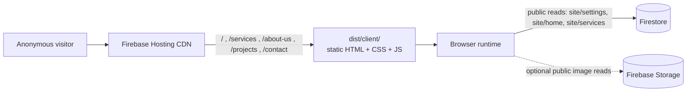

# ARCHITECTURE.md

Architecture for the Rajarata Engineering marketing website.

This file is the committed record of how the system is put together and *why*. It
supersedes the planning text in `IMPLEMENTATION.md`, which is a local-only
planning document. Where the two disagree, this file wins.

## Status legend

| Tag | Meaning |
| --- | --- |
| `implemented` | Exists in this checkout and builds today. |
| `open` | Needs a decision or a fact from the owner. Do not assume an answer. |

---

## 1. System overview



One delivery path, one codebase.

| Path | Content | Delivery |
| --- | --- | --- |
| Public site | Marketing pages, design tokens, fallback images | Fully static `dist/client/` on Firebase Hosting's CDN |
| Runtime content | Contact details, Home hero image and cards, Services copy and icons | Public-read Firestore documents hydrated in the browser |
| Media | Admin-uploaded Home images | Firebase Storage objects when available; otherwise compressed raster data URLs inside `site/home` |

The public site is deliberately static. Astro pre-renders every route at build
time, so there is no server runtime and no request-time rendering. The browser
reads three public Firestore documents (`site/settings`, `site/home`, and
`site/services`) and loads either public Firebase Storage images or inline
raster data URLs; writes are admin-only and enforced by rules. If a read fails
or a field is missing, the build-time markup stays in place — there is no
placeholder fallback. Dynamic behaviour also includes progressive enhancement:
scroll reveal, card pointer interaction, the mobile navigation drawer,
service-card specification disclosures, and project filtering.

---

## 2. Stack

Fixed. Do not substitute a layer without asking first.

| Layer | Choice | Status |
| --- | --- | --- |
| Front-end | Astro 7 + Tailwind CSS 4 (CSS-first `@theme`, no `tailwind.config.js`) | `implemented` |
| Output | `output: 'static'`, written to `dist/client/` | `implemented` |
| Hosting | Firebase Hosting serving `dist/client/`, no rewrites | `implemented`; not deployed |
| Content | Public-read Firestore `site/settings`, `site/home`, and `site/services`; optional public Storage images | `implemented` (written by the admin panel) |
| Contact | Direct WhatsApp and telephone links; no form, no backend | `implemented` |

No client-side UI framework. Interactivity is progressive enhancement in small
TypeScript modules and inline `<script>` blocks. No `.astro` component may ship an
inline `<style>` block.

---

## 3. Front-end architecture

### 3.1 Layouts

| File | Role | Status |
| --- | --- | --- |
| `src/layouts/Base.astro` | Document head: fonts, global styles, per-route title/description, script bootstraps | `implemented` |

There is one layout. `Base` takes `title` and `description` as props and writes
the meta tags directly; it reads no content source.

### 3.2 Pages

| Route | Source | Status |
| --- | --- | --- |
| `/` | `src/pages/index.astro` | `implemented` |
| `/services` | `src/pages/services.astro` | `implemented` |
| `/about-us` | `src/pages/about-us.astro` | `implemented` |
| `/projects` | `src/pages/projects.astro` | `implemented` |
| `/contact` | `src/pages/contact.astro` | `implemented` |

Every page sets `export const prerender = true`. Each page composes section
components and renders the shared header and footer around `<main>`.

### 3.3 Components

```
src/components/
  Container, Header, Footer, Logo                   # shared shell
  ui/        Button, Card, Chip, Field, WhatsAppIcon # presentational primitives
  home/      Hero, TrustStrip, AboutIntro, ServicesGrid, WhyChoose,
             ProjectsSection, ProjectCard, ClosingCta
  services/  ServicesHero, ServicesDirectory, ServiceCard, EngineeringProcess, ServicesCta
  about/     AboutHero, EngineeringHeritage, VisionMission, CorePillars,
             ProjectMethodology, IndustriesServed, AboutCta
  projects/  ProjectsHero, ProjectPortfolio, ProjectCard, ProjectTrackRecord, ProjectsCta
  contact/   ContactHero, OperationalDesks
```

Rules that hold across the whole tree:

- Section components are owned by one page and are never shared across pages.
- `ui/` primitives stay presentational. A primitive that imports content drags a
  content layer into every consumer, and there is no content layer.
- All styling is Tailwind utility classes. Design tokens live only in
  `src/styles/global.css`.

### 3.4 Design tokens

Single source: the `@theme` block in `src/styles/global.css`, ported from the
approved prototype design in `UI-UX-design/`. Tailwind 4 is CSS-first, so there is
no config file — editing tokens happens in the stylesheet, which must begin with
`@import "tailwindcss";`.

Tokens include the palette (primary red, ink, electric blue, energy orange), the
type scale (`display-hero`, `headline-*`, `title-*`, `body-*`, `label-*`), the
radii (`card` 18px, `control` 12px, `chip` 6px), and the three shadow levels.

Components use the tokens. Three prototype-faithful exceptions remain because the
approved palette has no matching token: `ClosingCta`'s `#111827` surface, the
`Chip` ELV/warning hex values, and the emerald/gray/white utility classes used on
dark sections.

### 3.5 Client runtime and helpers

| Module | Purpose | Status |
| --- | --- | --- |
| `src/lib/scrollReveal.ts` | Viewport reveal, respects `prefers-reduced-motion`, content visible without JS, never re-hides the first screen | `implemented` |
| `src/lib/cardTilt.ts` | Progressive pointer interaction on cards | `implemented` |
| `src/lib/contentHydration.ts` | Schedules the Firestore feeds after `load` on an idle slot, and only for feeds whose `data-*` hooks exist in the document | `implemented` |
| `src/lib/publicContact.ts` | Builds the WhatsApp and telephone actions from the two public environment values | `implemented` |
| `src/lib/whatsapp.ts` | WhatsApp number validation and `wa.me` link building | `implemented` |
| `src/lib/phone.ts` | International phone number validation and `tel:` link building | `implemented` |
| `src/lib/firebase.ts` | Lazily initialises the Firebase app and the named Firestore database | `implemented` |
| `src/lib/siteSettings.ts` | Reads and normalises `site/settings` | `implemented` |
| `src/lib/watchSiteSettings.ts` | Subscribes to `site/settings` and patches `data-site-*` elements, including the Services CTA actions | `implemented` |
| `src/lib/homeContent.ts` | Reads and validates `site/home`; types for the hero and three cards | `implemented` |
| `src/lib/watchHomeContent.ts` | Subscribes to `site/home` and patches `data-home-*` elements | `implemented` |
| `src/lib/servicesContentParser.ts` | Firebase-free types and strict/partial parsers for `site/services` | `implemented` |
| `src/lib/servicesContent.ts` | Static-Firebase wrapper; re-exports the parser and exposes `fetchServicesContent()` | `implemented` |
| `src/lib/watchServicesContent.ts` | Subscribes to `site/services` and patches `data-services-*` / `data-service-*` elements | `implemented` |

Every component still ships build-time copy and fallback artwork. Three client
modules hydrate opted-in fields from Firestore: `watchSiteSettings` for contact
details, `watchHomeContent` for the Home hero and three featured cards, and
`watchServicesContent` for Services copy, quick links, metrics, cards, process
steps, and CTA. A missing or malformed field is skipped, so the build-time
markup remains. There is no placeholder fallback.

Firestore is **not** on the critical path. `contentHydration.ts` waits for the
`load` event, takes an idle slot (capped at 2 s), and then dynamically imports
only the feeds the current document needs. The page is already complete from
static HTML before any of that happens, so the Firestore SDK (a ~140 KB gzipped
chunk) never delays the first paint and a feed with no hooks is never fetched.

### 3.6 Self-hosted webfonts

Neither webfont comes from a third party. `src/layouts/Base.astro` preloads the
two files it needs and `src/styles/global.css` declares the faces:

| File | Size | Notes |
| --- | --- | --- |
| `public/fonts/plus-jakarta-sans-latin.woff2` | 27 KB | Variable `wght` 200-800, `unicode-range` limited to latin |
| `public/fonts/plus-jakarta-sans-latin-ext.woff2` | 21 KB | Only downloaded when a latin-ext character appears |
| `public/fonts/material-symbols-outlined.woff2` | 8 KB | Static instance, subset to the 67 icons in use |

This replaced two render-blocking `fonts.googleapis.com` stylesheets and
Google's 3.83 MB full Material Symbols variable font. Both originals are the
same files Google serves, so the type is unchanged.

`.material-symbols-outlined` lives **outside** every cascade layer on purpose.
Google's stylesheet was unlayered, and unlayered declarations outrank all
layers, so the icons have always rendered at a fixed 24 px regardless of any
`text-*` utility on the span. Moving the rule into `@layer components` would
silently resize every icon on the site.

**Adding an icon.** The subset font only contains the names listed in the growth
set. Adding a new `<span class="material-symbols-outlined">name</span>` without
regenerating the font renders the literal word instead of a glyph. To rebuild:

```bash
pip install fonttools brotli          # one-off, not a project dependency
# 1. collect every icon name from src/ + dist/client/ HTML, plus SERVICE_ICONS
#    in src/lib/servicesContentParser.ts, into icons.txt (one name per line)
# 2. download the full variable font from fonts.gstatic.com/s/materialsymbolsoutlined/
# 3. instantiate FILL=0, GRAD=0, wght=400, opsz=24 with
#    fontTools.varLib.instancer
# 4. pyftsubset with layout_features=["*"], layout_closure=False and
#    populate(text="\n".join(icons), glyphs=[resolved ligature targets])
```

`layout_closure=False` matters: with closure on, the ligature alphabet pulls
every one of the font's 3,525 glyphs back in and the "subset" stays 250 KB.
After rebuilding, assert that each name still collapses to a single glyph
through the `liga` table and that the glyph draws at least one contour.

---

## 4. Content ownership

Every published string, image reference, and link has a build-time value owned by
the component that renders it. The admin panel can override three groups at
runtime:

- `site/settings` — contact details, links, and location label.
- `site/home` — the Home hero image and the three Featured Engineering Projects
  cards. Images are Firebase Storage URLs when a bucket exists; on the current
  Spark project they are compressed raster data URLs stored inline in the
  document.
- `site/services` — Services page copy and icon names in fixed slots. Numbers,
  anchors, accents, emphasis, contact actions, footer, header, images, and SEO
  remain build-time or come from `site/settings`.

Everything else is a code change and a rebuild.

- The browser only reads; Firestore and Storage rules allow writes to active
  admins only.
- `git` is the history for the build-time content. Firestore is the runtime
  history for the editable fields.
- Facts the owner has not supplied stay out of the markup. The Contact page shows
  a "Business address to be confirmed" notice because no verified address exists,
  and no prices are published anywhere.

---

## 5. Security boundaries

| Boundary | Enforcement point | Never rely on |
| --- | --- | --- |
| Public content | Static `dist/client/` plus public-read `site/settings`, `site/home`, and `site/services` | Runtime access control for reads |
| Public media | Public-read Firebase Storage objects or raster data URLs in `site/home`; admin-only writes | Obscurity |
| Writes | Firestore and Storage rules require an active admin record | Client-side validation alone |
| Secrets | No credentials in the repository, and none in `PUBLIC_*` variables | Obscurity |
| Forms | None exist; the site never writes to Firestore or Storage | — |
| Deploy | The `build:spark` audit plus an explicit `deploy:spark` confirmation | Manual `firebase deploy` |

The site reads `PUBLIC_WHATSAPP_NUMBER`, `PUBLIC_CONTACT_PHONE`, the six
`PUBLIC_FIREBASE_*` web-config values (plus optional
`PUBLIC_FIREBASE_DATABASE_ID`), and `PUBLIC_DEMO_MODE` for the build audit. All
are public by design and ship in the HTML or the client bundle; access is
enforced by rules, not by hiding them.

`npm run build:spark` scans the built output for credential patterns, temporary
image hosts, source maps, and placeholder markers, and verifies the five routes
and the direct contact links, before a deploy is allowed.

### 5.1 Threat model

**Assets:** the accuracy of the published site; the deploy path.

**Actors:** anonymous visitor (untrusted); owner and operator (trusted humans with
cloud access who deploy explicitly).

The attack surface is small by construction: static files, no server, no
sessions, no sensitive secrets, and no write path reachable from the browser.
The browser has read-only access to three public Firestore documents and their
public image sources (Storage or inline raster data URLs); writes are denied by
rules. The remaining risks are inaccurate content and an unauthorized deploy,
and both are addressed procedurally rather than technically.

---

## 6. Verification and release gates

Per change:

1. `npm run check` — 0 errors, 0 warnings, 0 hints.
2. `npm run build` and then `npm run test:spark`, `npm run test:services`,
   `npm run test:whatsapp`, `npm run test:phone` — or `npm run test:site` for all of them.
3. `npm run build:spark` — build plus artifact audit.

Release approval:

- **Developer gate:** `check`, `build`, and all four test files pass.
- **Owner gate:** content facts (contact details, address, certifications,
  projects, performance claims) verified by the owner before the first production
  deploy.
- **Explicit authorization required** before creating or changing Firebase
  projects or enabling billing, and before every deployment.

### Build commands (today)

```sh
npm ci
npm run check         # astro check — must report 0 errors, 0 warnings, 0 hints
npm run build         # five static routes into dist/client/
npm run test:site     # check + build + spark/services/whatsapp/phone tests
npm run build:spark   # check + build + audit the deployable artifact
```

Deployment is not performed by these commands. Do not run `firebase deploy` by
hand without asking.

---

## 7. Open items

These are unanswered. Do not assume an answer.

| # | Item | Blocks |
| --- | --- | --- |
| O1 | Confirmed WhatsApp number and telephone number | They are currently placeholders in `.env.example`, so the Contact page links do not reach the business |
| O2 | Verified business address | The Contact page shows a "Business address to be confirmed" notice and does not link to a map |
| O3 | Production Firebase project (id and billing owner) | Production deploy. The only project is `rajarata-engineering-admin` (Spark, billing disabled, no Storage bucket); Blaze needs a billing account, which is not configured. Home image saves work through the inline-media fallback meanwhile |
| O4 | Who verifies factual claims (certifications, projects, metrics, years) before the first production deploy? | Owner gate |
| O5 | Fixed price per service, or quoted per project? | No prices are published anywhere and no price shape has been agreed |
| O6 | Should root `DESIGN.md` be restored? It was removed in commit `fc57401`. | Future UI work |

---

## 8. Related documents

| Document | Scope | Tracked |
| --- | --- | --- |
| `ARCHITECTURE.md` | This file — system design | Yes |
| `README.md` | Local setup, scripts, front-end structure | Yes |
| `AGENTS.md` | Working agreements and build workflow for agents | No — gitignored |
| `IMPLEMENTATION.md` | Ordered build plan and phase records | No — gitignored |
| `UI-UX-design/` | Approved prototype design source, read-only | No — gitignored |
