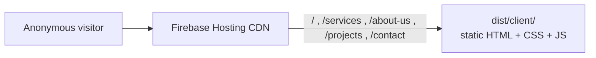

# ARCHITECTURE.md

Architecture for the Rajarata Engineering marketing website.

This file is the committed record of how the system is put together and *why*. It
supersedes the planning text in `IMPLEMENTATION.md`, which is a local-only
planning document. Where the two disagree, this file wins.

## Status legend

| Tag | Meaning |
| --- | --- |
| `implemented` | Exists in this checkout and builds today. |
| `open` | Needs a decision or a fact from the owner. Do not assume an answer. |

---

## 1. System overview



One delivery path, one codebase.

| Path | Content | Delivery |
| --- | --- | --- |
| Public site | Marketing pages, design tokens, static images | Fully static `dist/client/` on Firebase Hosting's CDN |

The public site is deliberately static. Astro pre-renders every route at build
time, so there is no server runtime, no database, and no request-time rendering.
Dynamic behaviour is limited to progressive enhancement in the browser: scroll
reveal, card pointer interaction, the mobile navigation drawer, service-card
specification disclosures, and project filtering.

---

## 2. Stack

Fixed. Do not substitute a layer without asking first.

| Layer | Choice | Status |
| --- | --- | --- |
| Front-end | Astro 7 + Tailwind CSS 4 (CSS-first `@theme`, no `tailwind.config.js`) | `implemented` |
| Output | `output: 'static'`, written to `dist/client/` | `implemented` |
| Hosting | Firebase Hosting serving `dist/client/`, no rewrites | `implemented`; not deployed |
| Contact | Direct WhatsApp and telephone links; no form, no backend | `implemented` |

No client-side UI framework. Interactivity is progressive enhancement in small
TypeScript modules and inline `<script>` blocks. No `.astro` component may ship an
inline `<style>` block.

---

## 3. Front-end architecture

### 3.1 Layouts

| File | Role | Status |
| --- | --- | --- |
| `src/layouts/Base.astro` | Document head: fonts, global styles, per-route title/description, script bootstraps | `implemented` |

There is one layout. `Base` takes `title` and `description` as props and writes
the meta tags directly; it reads no content source.

### 3.2 Pages

| Route | Source | Status |
| --- | --- | --- |
| `/` | `src/pages/index.astro` | `implemented` |
| `/services` | `src/pages/services.astro` | `implemented` |
| `/about-us` | `src/pages/about-us.astro` | `implemented` |
| `/projects` | `src/pages/projects.astro` | `implemented` |
| `/contact` | `src/pages/contact.astro` | `implemented` |

Every page sets `export const prerender = true`. Each page composes section
components and renders the shared header and footer around `<main>`.

### 3.3 Components

```
src/components/
  Container, Header, Footer, Logo                   # shared shell
  ui/        Button, Card, Chip, Field, WhatsAppIcon # presentational primitives
  home/      Hero, TrustStrip, AboutIntro, ServicesGrid, WhyChoose,
             ProjectsSection, ProjectCard, ClosingCta
  services/  ServicesHero, ServicesDirectory, ServiceCard, EngineeringProcess, ServicesCta
  about/     AboutHero, EngineeringHeritage, VisionMission, CorePillars,
             ProjectMethodology, IndustriesServed, AboutCta
  projects/  ProjectsHero, ProjectPortfolio, ProjectCard, ProjectTrackRecord, ProjectsCta
  contact/   ContactHero, OperationalDesks
```

Rules that hold across the whole tree:

- Section components are owned by one page and are never shared across pages.
- `ui/` primitives stay presentational. A primitive that imports content drags a
  content layer into every consumer, and there is no content layer.
- All styling is Tailwind utility classes. Design tokens live only in
  `src/styles/global.css`.

### 3.4 Design tokens

Single source: the `@theme` block in `src/styles/global.css`, ported from the
approved prototype design in `UI-UX-design/`. Tailwind 4 is CSS-first, so there is
no config file — editing tokens happens in the stylesheet, which must begin with
`@import "tailwindcss";`.

Tokens include the palette (primary red, ink, electric blue, energy orange), the
type scale (`display-hero`, `headline-*`, `title-*`, `body-*`, `label-*`), the
radii (`card` 18px, `control` 12px, `chip` 6px), and the three shadow levels.

Components use the tokens. Three prototype-faithful exceptions remain because the
approved palette has no matching token: `ClosingCta`'s `#111827` surface, the
`Chip` ELV/warning hex values, and the emerald/gray/white utility classes used on
dark sections.

### 3.5 Client runtime and helpers

| Module | Purpose | Status |
| --- | --- | --- |
| `src/lib/scrollReveal.ts` | Viewport reveal, respects `prefers-reduced-motion`, content visible without JS | `implemented` |
| `src/lib/cardTilt.ts` | Progressive pointer interaction on cards | `implemented` |
| `src/lib/publicContact.ts` | Builds the WhatsApp and telephone actions from the two public environment values | `implemented` |
| `src/lib/whatsapp.ts` | WhatsApp number validation and `wa.me` link building | `implemented` |
| `src/lib/phone.ts` | International phone number validation and `tel:` link building | `implemented` |

All rendered copy is resolved at build time by the component that owns it. No
module fetches content.

---

## 4. Content ownership

Every published string, image reference, and link is owned by the component that
renders it.

- There is no runtime fetch and no external document.
- Changing copy is a code change and a rebuild.
- `git` is the only history for public content.
- Facts the owner has not supplied stay out of the markup. The Contact page shows
  a "location details to be confirmed" notice because no verified address exists,
  and no prices are published anywhere.

---

## 5. Security boundaries

| Boundary | Enforcement point | Never rely on |
| --- | --- | --- |
| Public content | Static `dist/client/` built from this repository | Runtime access control |
| Secrets | No credentials in the repository, and none in `PUBLIC_*` variables | Obscurity |
| Forms | None exist, and no backend endpoints exist | — |
| Deploy | The `build:spark` audit plus an explicit `deploy:spark` confirmation | Manual `firebase deploy` |

The only environment values the site itself reads are `PUBLIC_WHATSAPP_NUMBER`
and `PUBLIC_CONTACT_PHONE`. Both are deliberately public and ship in the HTML.
`scripts/build-spark.mjs` also reads `PUBLIC_DEMO_MODE` for its content gate.

`npm run build:spark` scans the built output for credential patterns, temporary
image hosts, source maps, and placeholder markers, and verifies the five routes
and the direct contact links, before a deploy is allowed.

### 5.1 Threat model

**Assets:** the accuracy of the published site; the deploy path.

**Actors:** anonymous visitor (untrusted); owner and operator (trusted humans with
cloud access who deploy explicitly).

The attack surface is small by construction: static files, no server, no database,
no sessions, no secrets, and no write path reachable from the browser. The
remaining risks are inaccurate content and an unauthorized deploy, and both are
addressed procedurally rather than technically.

---

## 6. Verification and release gates

Per change:

1. `npm run check` — 0 errors, 0 warnings, 0 hints.
2. `npm run build` and then `npm run test:spark`, `npm run test:whatsapp`,
   `npm run test:phone` — or `npm run test:site` for all of them.
3. `npm run build:spark` — build plus artifact audit.

Release approval:

- **Developer gate:** `check`, `build`, and all three test files pass.
- **Owner gate:** content facts (contact details, address, certifications,
  projects, performance claims) verified by the owner before the first production
  deploy.
- **Explicit authorization required** before creating or changing Firebase
  projects or enabling billing, and before every deployment.

### Build commands (today)

```sh
npm ci
npm run check         # astro check — must report 0 errors, 0 warnings, 0 hints
npm run build         # five static routes into dist/client/
npm run test:site     # check + build + spark/whatsapp/phone tests
npm run build:spark   # check + build + audit the deployable artifact
```

Deployment is not performed by these commands. Do not run `firebase deploy` by
hand without asking.

---

## 7. Open items

These are unanswered. Do not assume an answer.

| # | Item | Blocks |
| --- | --- | --- |
| O1 | Confirmed WhatsApp number and telephone number | They are currently placeholders in `.env.example`, so the Contact page links do not reach the business |
| O2 | Verified business address | The Contact page shows a "location details to be confirmed" notice and does not link to a map |
| O3 | Production Firebase project (id and billing owner) | Any production deploy. `rajarata-engineering-developer` is on the Spark plan with billing disabled |
| O4 | Who verifies factual claims (certifications, projects, metrics, years) before the first production deploy? | Owner gate |
| O5 | Fixed price per service, or quoted per project? | No prices are published anywhere and no price shape has been agreed |
| O6 | Should root `DESIGN.md` be restored? It was removed in commit `fc57401`. | Future UI work |

---

## 8. Related documents

| Document | Scope | Tracked |
| --- | --- | --- |
| `ARCHITECTURE.md` | This file — system design | Yes |
| `README.md` | Local setup, scripts, front-end structure | Yes |
| `AGENTS.md` | Working agreements and build workflow for agents | No — gitignored |
| `IMPLEMENTATION.md` | Ordered build plan and phase records | No — gitignored |
| `UI-UX-design/` | Approved prototype design source, read-only | No — gitignored |
